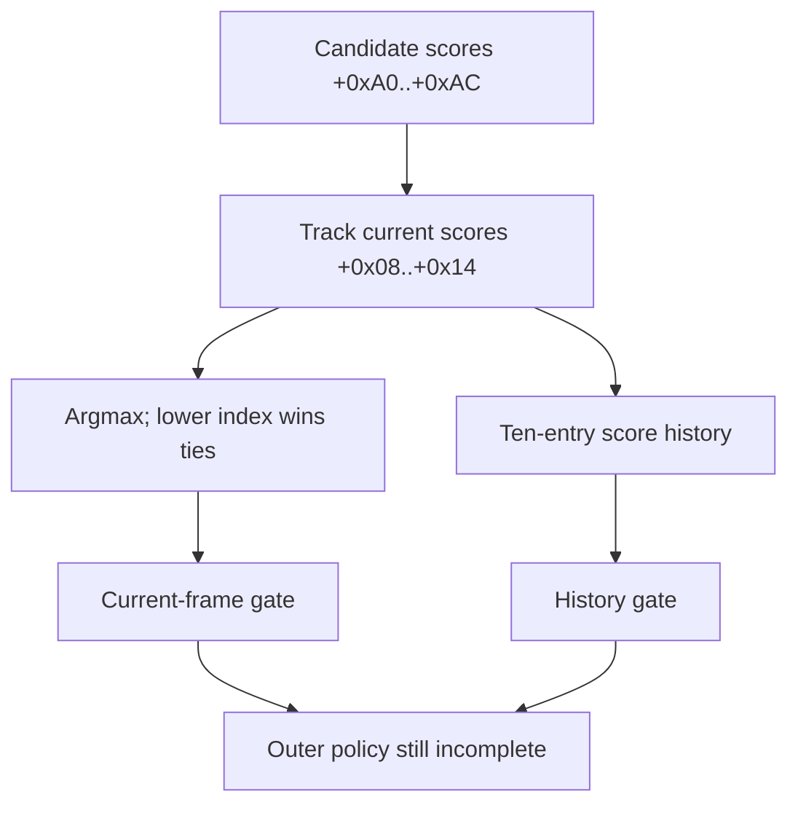

# Windows 0C19 numeric class-transition gates — 2026-10-18

## Result

`userspace/surface-processor/windows_class_transition.py` is a clean-room,
parameterized implementation of the numeric argmax and the two gates directly
visible in `FUN_180607050` and `FUN_1806071c0`. It does not assign class names,
run the surrounding `FUN_1806067d0` policy, apply `FUN_180607660` corrections,
or emit contacts.

The recovered pipeline at this boundary is:

## Configuration and numeric domains

Initialization stores `DAT_1808e0460 + 0xecc` at tracker context `+0x16480`.
Relative to that object, transition entry `(old * 4 + proposed)` begins at
`+0x8d8 + index*0x30`.

The table is **5x4**, not 4x4. A stored old class may be numeric `0..4`; a new
score proposal is numeric `0..3`. New tracks are initialized with stored class
`4`. No semantic labels are claimed.

| Field | Entry offset | Use |
|---|---:|---|
| history margins | `+0x28..+0x37`, four `s32` | proposed score minus each competing score over selected history |
| current margins | `+0x3c..+0x4b`, four `s32` | same comparison for the current score vector |
| absolute floor | `+0x4c`, `s16` | minimum proposed score |
| candidate-flag bias | `+0x4e`, `s8` | conditional margin/floor adjustment |
| history window | `+0x4f`, `u8` | number of newest ring samples required |
| mode-1 current enable | `+0x51`, byte | rejects the current gate when zero in mode 1 |
| mode-1 window addition | config `+0x92a + index*0x30`, `s8` | added with byte wrapping to the history window |

The mode-1 candidate bias at config `+0x8f2` is global. The two functions use
the candidate flag differently: the current gate adds the entry bias and, in
mode 1, the global bias; the history gate selects the entry bias outside mode 1
or the global bias in mode 1.

## Gate behavior

The current-frame gate rejects when mode 1 disables the entry, any required
pairwise margin is missed, or the proposed score is below its adjusted floor.
A separately evaluated spatial predicate on numeric `4 -> 0` forces the
current absolute floor to `20` and adds a global spatial margin bias. The API
requires callers to pass that predicate and bias explicitly.

The history gate immediately accepts `old == proposed`. Otherwise it requires
enough history and checks every selected sample, newest first, against all
three competing margins and the absolute floor. The ring in Windows contains
up to ten entries; the implementation accepts an already ordered sequence so
ring storage mechanics cannot be confused with decision arithmetic.

The pinned shifted image produces internally plausible gate values, including
different current and historical margins and nonzero windows. Those Microsoft
bytes are not copied into the repository; the parser consumes a caller-
provided configuration view.

## What remains unresolved

`FUN_1806067d0` surrounds these gates with age, size, signal, spatial, and
class-specific checks. It may retain the old class even after argmax, and
`FUN_180607660` can later rewrite state from multi-frame features. The score
kernel also has three override paths that are still excluded. Therefore:

- argmax is a proposal, not a published contact classification;
- a passing gate is not sufficient to predict final state;
- numeric classes must not be mapped to finger, palm, merged, or hover names;
- the implementation must remain offline until the outer policy is complete
  and validated against frame-aligned Windows observations.

## Tests

Focused tests cover lower-index ties, all-competitor margins, absolute floors,
mode-1 enable and biases, the special `4 -> 0` floor, history depth and
newest-first windows, the same-class shortcut, signed field decoding, the full
5x4 layout, and malformed/non-finite inputs.
